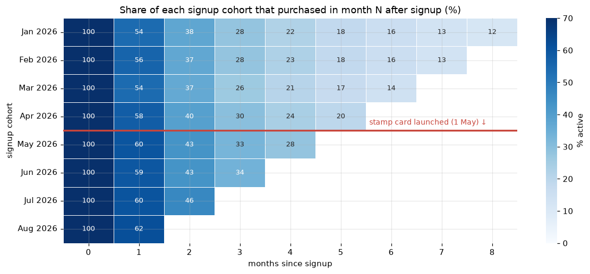
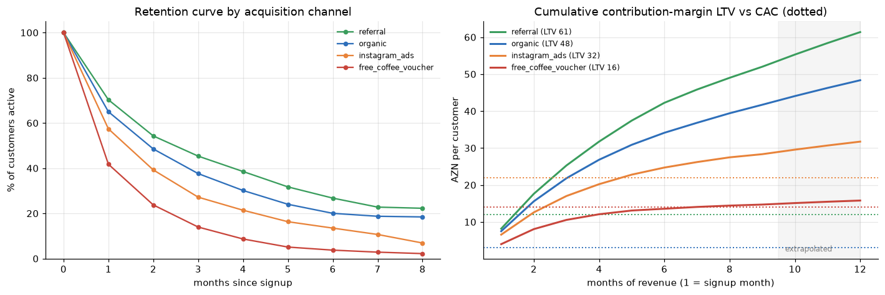
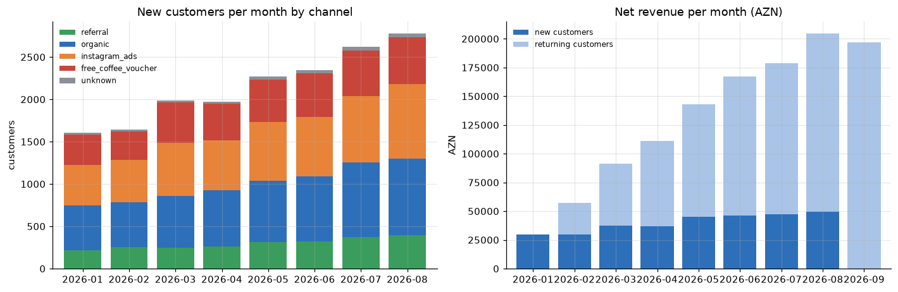

# ☕ Cohort Retention & Customer LTV — Baku Coffee-Chain Loyalty App

> **Daily Data Analytics Project · Day 05**

Monthly cohort analysis for a 12-store coffee chain in Baku: how fast do loyalty-app customers drop off, did the new **digital stamp card** make them stickier, and which **acquisition channel** actually pays back its cost?

## 🎯 Business question
~17K customers joined the loyalty app between **Jan and Aug 2026** (transactions observed until 30 Sep 2026) through four channels: organic, friend referral, Instagram ads and a "first coffee free" voucher. On **1 May 2026** the app launched a stamp card (every 8th coffee free).

1. How quickly do customers churn, and is retention improving across monthly cohorts?
2. Did the **stamp card** improve retention?
3. Which channel brings the highest **12-month LTV**, and does each channel recover its **CAC**?
4. Is there an early **activation signal** that predicts who stays?

## 📊 Key results

| KPI | Value |
|---|---|
| Customers acquired (Jan–Aug) | **17,222** |
| Net revenue Jan–Sep | **1.18M AZN** |
| Purchases per customer · avg ticket | 10.4 · 6.59 AZN |
| Month-1 / Month-3 / Month-6 retention | **58.3% / 30.1% / 15.2%** |
| Active customers in Sep 2026 | 5,436 |
| Share of Aug revenue from returning customers | 75.9% |
| Data issues fixed | 2,735 rows removed (1,085 POS duplicates, 1,511 staff test-account txns, 150 pre-signup clock errors); 320 refunds netted; 258 missing channels → `unknown` |



### Stamp-card effect (before vs after 1 May cohorts)
| Month | Jan–Apr cohorts | May–Aug cohorts | Lift | p-value |
|---|---|---|---|---|
| M1 | 55.4% | 60.4% | +4.9 pp (+9%) | < 0.001 |
| M2 | 37.7% | 44.3% | +6.6 pp (+17%) | < 0.001 |
| M3 | 28.0% | 33.4% | +5.4 pp (+19%) | < 0.001 |

Channel mix is unchanged between periods (χ² p = 0.34) and the lift appears inside **every** channel (largest for voucher users, +45% M2 retention). Estimated value: 12-month LTV **37.5 → 42.2 AZN** per customer ≈ **146K AZN** extra contribution margin per year.

### Channel economics (12-month LTV at 35% contribution margin)
| Channel | Customers | M1 ret. | M3 ret. | 12-mo LTV | CAC* | LTV / CAC | Payback |
|---|---|---|---|---|---|---|---|
| Referral | 2,379 | 70.3% | 45.4% | **61.4 AZN** | 12 | 5.1× | 2 months |
| Organic | 5,616 | 65.0% | 37.6% | 48.3 AZN | 3 | **16.1×** | 1 month |
| Instagram ads | 5,255 | 57.4% | 27.2% | 31.7 AZN | 22 | 1.4× | 5 months |
| Free-coffee voucher | 3,714 | 41.8% | 14.0% | 15.8 AZN | 14 | **1.1×** | 7 months |

<sub>*CAC values are assumptions for illustration. Months 9–12 are extrapolated with a fitted power-law retention curve `r(m) = a·m^(−b)`.</sub>



**Activation:** customers who make a **2nd purchase within 14 days** (66% of all) have **38.9%** month-3 retention vs **12.5%** for those who don't.



## 💡 Recommendations
1. **Keep the stamp card** and A/B test a 6-stamp vs 8-stamp card to confirm causality and tune its cost.
2. **Move budget from free-coffee vouchers to referrals** — vouchers barely break even (1.1×, 7-month payback); if vouchers stay, release the free coffee only after a 2nd paid purchase.
3. **Don't scale Instagram ads at the current CAC** — 1.4× is thin; target ≤ 15 AZN CAC (≈ 2×) with lookalikes of referral customers.
4. **Make "2nd coffee within 14 days" the onboarding North-Star** — push notification + double stamp on days 3–7.
5. **Concentrate win-back on days 15–45**, where most customers are lost; the curve flattens after month 4 (loyal core ≈ 15%).

## 🛠 Tech stack
Python · pandas (cohort matrices, period arithmetic) · NumPy · SciPy (`curve_fit` power-law retention, two-proportion z-test, χ²) · matplotlib · seaborn · Jupyter

## 📁 Structure
```
├── cohort_retention_ltv.ipynb  # full analysis (data checks → KPIs → cohorts → LTV/CAC → recommendations)
├── build_notebook.py           # builds the notebook with nbformat
├── data/
│   ├── generate_data.py        # reproducible synthetic dataset generator
│   ├── customers.csv           # 17,247 customers (incl. 25 test accounts)
│   └── transactions.csv        # 182,403 transaction rows (incl. dirty rows)
├── images/                     # exported charts
└── requirements.txt
```

## ▶️ Run it
```bash
pip install -r requirements.txt
python data/generate_data.py   # optional: regenerate the dataset
python build_notebook.py       # optional: rebuild the notebook
jupyter notebook cohort_retention_ltv.ipynb
```

> ℹ️ The dataset is **synthetic** (generated with a fixed seed), modelled on typical loyalty-app behaviour, including deliberate data-quality problems. CAC figures and the 35% contribution margin are assumptions. The stamp-card effect is a before/after estimate, not a randomised experiment. No real company or customer data is used.

---

### 🇦🇿 Azərbaycanca xülasə
Bakıdakı kofe şəbəkəsinin loyallıq tətbiqi üzrə **aylıq kohort retention və LTV analizi** (~17 min müştəri, 180 min əməliyyat). Yeni müştərilərin yalnız **58%-i** 1-ci ayda, **30%-i** 3-cü ayda geri qayıdır. 1 May-da işə salınan **rəqəmsal möhür kartı** sonrakı kohortların retention-unu **+9–19%** artırıb (bütün kanallarda), bu da illik ≈ **146 min AZN** əlavə marja deməkdir. Ən dəyərli kanal **dost tövsiyəsidir** (12 aylıq LTV 61 AZN, LTV/CAC 5.1×); **"pulsuz kofe" vaučeri** isə çətinliklə xərcini çıxarır (1.1×, 7 ay). İlk 14 gündə 2-ci alış edən müştərilərin 3-cü ay retention-u **39%**, etməyənlərin **12.5%**-dir. Tövsiyə: büdcəni vaučerdən referal proqrama keçirmək və "14 gündə 2-ci kofe"ni onboarding hədəfi etmək.
